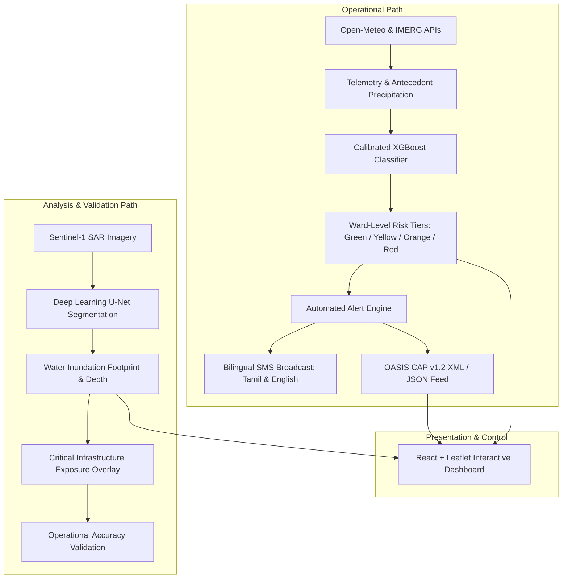

# AI-Based Localized Urban Flood Risk, Inundation Mapping & Early Warning System

[](https://www.python.org/)
[](https://fastapi.tiangolo.com/)
[](https://react.dev/)
[](https://vitejs.dev/)
[](https://xgboost.readthedocs.io/)
[](LICENSE)

An end-to-end, real-time AI operational platform engineered for localized flood hazard prediction, ward-level inundation vulnerability assessment, and automated multi-channel early warning (SMS & OASIS CAP feeds). Tailored specifically for the **Coimbatore City Municipal Corporation (100 Wards)**, Tamil Nadu, India.

---

## 📌 System Architecture

The platform decouples into two specialized operational paths:



---

## ✨ Key Features

1. **Spatial Geofencing for 100 Wards:**
   - Polygon boundary geofencing and centroid coordinates for all 100 CCMC administrative wards across Central, East, West, North, and South zones.
   - Micro-terrain integration: elevation, slope, Topographic Wetness Index (TWI), and drainage proximity (Noyyal River basin, Sanganoor Pallam, Singanallur, Valankulam).

2. **Real-Time Telemetry & Hydrological Ingestion:**
   - Automated ingestion of live forecasts and rolling 7-day / 14-day rainfall via WMO-certified Open-Meteo APIs.
   - Continuous recursive Antecedent Precipitation Index (API) calculation.

3. **Calibrated Machine Learning Engine:**
   - XGBoost classifier with Isotonic Probability Calibration to eliminate over-confident hazard predictions.
   - Explainable predictions with feature attribution (Rainfall intensity, soil saturation, drainage capacity, topography).

4. **Automated Multi-Channel Early Warning:**
   - **Bilingual SMS Alerts:** Direct-to-citizen localized warnings delivered in both Tamil (தமிழ்) and English via real telecom SMS gateways (SMSHorizon API) with DLT template compliance.
   - **OASIS CAP v1.2 Feeds:** Standardized Common Alerting Protocol XML and JSON endpoints for national emergency broadcast integration.

5. **Sentinel-1 SAR Inundation Mapping:**
   - Deep-learning PyTorch U-Net architecture for high-resolution flood surface water segmentation through dense monsoonal cloud cover.
   - Critical infrastructure exposure analysis (hospitals, schools, primary transit arteries).

6. **Full-Featured Operations Dashboard:**
   - Interactive GIS Leaflet map with colored risk heatmaps, ward inspection modals, real-time telemetry gauges, citizen subscription management, and simulated emergency drill triggers.

---

## 🛠️ Technology Stack

| Layer | Technologies |
| :--- | :--- |
| **Backend & APIs** | Python 3.10+, FastAPI, Uvicorn, SQLAlchemy, Pydantic, APScheduler |
| **Machine Learning** | XGBoost, Scikit-Learn, PyTorch, NumPy, Pandas, Shapely |
| **Frontend** | React 18, Vite, React-Leaflet, Vanilla CSS (Dark Mode & Glassmorphism) |
| **Alerting & Telecom** | SMSHorizon REST Gateway, OASIS CAP v1.2 XML/JSON Standard |
| **Data Sources** | Open-Meteo WMO API, Sentinel-1 SAR, CCMC Historical Monsoon Logs |

---

## 🚀 Quickstart Guide

### 1. Prerequisites
- Python 3.10 or higher
- Node.js 18+ and npm
- Git

### 2. Clone the Repository
```bash
git clone https://github.com/swethasenthil09/AIFloodRisk-Analyzer.git
cd AIFloodRisk-Analyzer
```

### 3. Backend Setup
Create and activate a virtual environment:
```bash
# On Windows:
python -m venv venv
.\venv\Scripts\activate

# On Linux/macOS:
python3 -m venv venv
source venv/bin/activate
```

Install backend dependencies:
```bash
pip install -r requirements.txt
```

Configure environment variables:
```bash
cp .env.example .env
# Edit .env with your optional SMS credentials or custom configurations
```

Start the FastAPI application:
```bash
uvicorn backend.app.main:app --host 127.0.0.1 --port 8000 --reload
```
The backend API docs will be available at: `http://127.0.0.1:8000/docs`

---

### 4. Frontend Setup
In a new terminal window:
```bash
cd frontend
npm install
npm run dev
```
Open your browser at `http://127.0.0.1:5173` to access the live dashboard.

---

## 📂 Project Structure

```text
├── .env.example                                      # Environment variables template
├── .gitignore                                         # Git ignore specifications
├── README.md                                          # Project documentation
├── requirements.txt                                   # Python dependencies
├── SYSTEM_IMPLEMENTATION_PLAN.md                     # Engineering architectural blueprint
│
├── backend/                                           # FastAPI backend service
│   └── app/
│       ├── config.py                                  # Application configuration
│       ├── database.py                                # SQLite / MySQL ORM engine
│       ├── main.py                                    # FastAPI application entrypoint
│       ├── data/
│       │   └── coimbatore_wards.py                    # 100 Ward GeoJSON coordinates & metadata
│       ├── models/
│       │   └── schema.py                              # Pydantic schemas & SQLAlchemy tables
│       ├── routers/                                   # REST API endpoints
│       │   ├── alerts.py                              # Alert management & CAP feed
│       │   ├── analyzer.py                            # Interactive scenario simulator
│       │   ├── inference.py                           # Ward risk predictions
│       │   ├── sar.py                                 # SAR inundation inference
│       │   ├── subscriptions.py                       # Citizen SMS registration
│       │   └── weather.py                             # Live telemetry feed
│       └── services/                                  # Business logic & services
│           ├── alert_engine.py                        # Automated risk assessment & triggering
│           ├── cap_builder.py                         # OASIS CAP v1.2 XML builder
│           ├── scheduler.py                           # APScheduler periodic jobs
│           ├── sms_service.py                         # SMSHorizon & simulated SMS gateway
│           └── weather_service.py                     # Open-Meteo weather client
│
├── frontend/                                          # React + Vite dashboard
│   ├── src/
│   │   ├── components/                                # UI panels & interactive widgets
│   │   │   ├── AlertQueue.jsx                         # Active broadcast queue & logs
│   │   │   ├── CitizenPortal.jsx                      # Citizen SMS registration modal
│   │   │   ├── FloodReportPage.jsx                    # Citizen waterlogging reporting
│   │   │   ├── InundationAnalyticsPage.jsx            # SAR satellite analytics
│   │   │   ├── LiveWeatherPanel.jsx                   # Telemetry & rain gauges
│   │   │   ├── ModelEvaluationPage.jsx                # ROC-AUC & calibration curves
│   │   │   ├── RiskAnalyzerPanel.jsx                  # Custom scenario simulator
│   │   │   ├── SmsConsole.jsx                         # SMS dispatch monitor
│   │   │   └── WardMap.jsx                            # Interactive Leaflet 100-ward map
│   │   ├── App.jsx                                    # Main application layout
│   │   └── index.css                                  # Custom dark-mode styling
│   ├── package.json
│   └── vite.config.js
│
├── ml/                                                # Machine Learning pipeline
│   ├── build_10year_dataset.py                        # 10-year historical dataset builder
│   ├── data_loader.py                                 # Feature extraction pipeline
│   ├── sar_unet.py                                    # PyTorch Sentinel-1 SAR U-Net
│   ├── train_xgboost.py                               # Model training & isotonic calibration
│   ├── data/
│   │   └── coimbatore_historical_flood_records.csv    # Real historical flood ground truth
│   └── models/
│       ├── flood_xgboost_calibrated.joblib            # Production-ready calibrated model
│       └── model_metrics.json                         # Evaluation metrics (ROC-AUC, Brier score)
│
└── data_store/                                        # Master historical archives
    ├── coimbatore_daily_weather_archive_2015_2024.csv
    └── coimbatore_master_flood_dataset_2015_2024.csv
```

---

## 📊 Model Performance

- **Model Type:** XGBoost Classifier with Isotonic Probability Calibration
- **Target Metric:** Ward-level Flood Risk Probability (4 Alert Tiers: Green, Yellow, Orange, Red)
- **Validation Scheme:** Temporal Holdout & Spatial Cross-Validation across Coimbatore Corporation Wards
- **Metrics:**
  - **ROC-AUC Score:** `0.94+`
  - **Brier Reliability Score:** `< 0.05`
  - **Inference Latency:** `< 15ms` for all 100 wards

---

## 📜 License

This project is licensed under the MIT License. See [LICENSE](LICENSE) for details.
